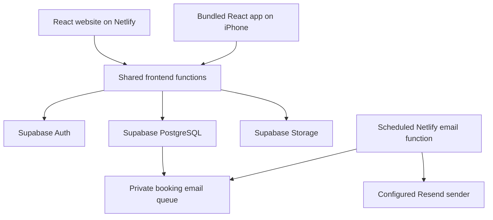

# airstethics

A beauty booking marketplace for Alberta, Canada. Discover independent hair, nail, skincare, brow, makeup, and massage experiences in Edmonton, Calgary, and Canmore.

This is an early marketplace with fictional sample providers and host-created spaces. It works as a browser demo or connects to Supabase for accounts, shared listings, private bookings, and host availability. Booking emails for real host-created spaces require a configured email provider; fictional sample spaces do not send emails. No payments are collected and providers are not verified.

This README explains how the app's features work together. The
[frontend function reference](src/README.md) documents the individual functions,
their inputs, outputs, side effects, and error behavior. Code being implemented
does not mean that its production settings or App Store release are complete.

## Documentation map

| Guide                                               | What it explains                                                                              |
| --------------------------------------------------- | --------------------------------------------------------------------------------------------- |
| [Frontend functions](src/README.md)                 | Components, state, API calls, accounts, storage, photo processing, and availability helpers.  |
| [Database](supabase/README.md)                      | Tables, RPC signatures, authorization, transactions, migration order, and SQL checks.         |
| [Migration recovery](supabase/repairs/README.md)    | Recording an existing manual schema without recreating or deleting its app tables.            |
| [Email functions](netlify/README.md)                | Scheduled worker inputs/outputs, templates, leases, retries, and provider requests.           |
| [Email configuration](docs/booking-emails.md)       | Verified sender domain and server-only Netlify settings.                                      |
| [iPhone project](ios/README.md)                     | Native files, shared data, callback functions, and platform responsibilities.                 |
| [iPhone release guide](docs/iphone.md)              | Mac/Xcode setup, signing, device tests, TestFlight, and remaining release work.               |
| [Native dependencies](ios/App/CapApp-SPM/README.md) | Generated Swift Package Manager container and Capacitor synchronization.                      |
| [Maps](public/maps/README.md)                       | Pins, clusters, selected listing details, map bounds, fallback layers, sources, and licences. |
| [Neighbourhoods](public/locations/README.md)        | Matching, ambiguous names, manual pins, historical data, and coverage.                        |
| [Guide index](docs/README.md)                       | Where to start for a specific task.                                                           |

## How the app is connected



React handles screens and forms. `useMarketplace()` coordinates account state,
data loading, demo storage, and mutations. `backend.ts` translates frontend
actions into database queries or RPC calls. Supabase enforces the actual access
and booking rules. Netlify's email worker runs separately from the browser or
phone, so private email-provider credentials are never needed in either app.

## Demo mode versus connected mode

[`backend.ts`](src/backend.ts) selects the mode from build-time settings:

| Settings                              | Behavior                                                                           |
| ------------------------------------- | ---------------------------------------------------------------------------------- |
| Neither Supabase URL nor public key   | Browser demo with fictional source listings and locally created data.              |
| Valid URL and public key              | Shared database, real account ownership, and protected customer/host records.      |
| Only one setting, or invalid settings | A connection error; configured cloud actions do not silently save to demo storage. |

Demo mode uses these browser keys:

| Key                     | Saved value                                                              |
| ----------------------- | ------------------------------------------------------------------------ |
| `airstethics:saved`     | Listing IDs the browser has favourited.                                  |
| `airstethics:listings`  | Locally created spaces and compressed demo photos.                       |
| `airstethics:bookings`  | Demo appointments and their entered contact details. Use sample details. |
| `airstethics:schedules` | Availability objects keyed by local space ID.                            |

`readStored()` validates JSON and falls back safely if it is malformed or
unavailable. **Privacy & demo info → Clear my demo data** clears demo state.
Existing demo records are not uploaded when connecting Supabase. Connected
booking/contact records stay out of those demo keys; Supabase separately
persists session credentials so it can restore login.

## How each customer function works

### Search and discovery

`App` filters the loaded listings, then sends matching results to cards and the
map. Search is case-insensitive and checks the listing name, category, city,
neighbourhood, description, and service names. The location selector matches a
supported city. Submitting Search applies the current inputs.

The price filter compares the cheapest service on a listing with the maximum;
the default value `300` means no price restriction. **Highly rated** requires
a rating of at least `4.9`. Price sorting uses the cheapest service, rating
sorting uses the listing rating, and **Recommended** preserves the current
order rather than running a personalized recommendation algorithm.

Panning does not automatically submit a geographic filter. **Search this area**
applies map bounds; **Clear map area** removes that restriction. The map can
be explored worldwide, while new listings currently must be in Edmonton,
Calgary, or Canmore.

### Listing details and map selection

`openListingDetails(listing)` remembers the previous view, map/list preference,
scroll position, and originating listing action. It opens the details beside
that listing's selected map point. On mobile, the map is above the details.
Selecting another pin updates details when that view is already open.
**Back to results** restores the previous context and attempts to restore focus.

**On map** locates a listing without booking it. A map preview's **View & book**
action can open booking directly. Points can be approximate neighbourhood or
legacy city locations; they are not verified business addresses. See the
[map function guide](public/maps/README.md).

### Favourites

Tapping a heart calls `toggleSave(id)`. Connected mode first requires a ready
account, then `saveFavourite()` inserts or deletes that account's favourite
under the database ownership rules. Cloud state and success feedback update
after the request succeeds. A per-account/listing in-flight guard prevents
duplicate simultaneous requests. Demo mode updates the browser's saved IDs.

### Booking

1. Open the booking form and choose a service and an Alberta-local date.
2. `availableSlots(listingId, date, serviceId)` loads starts for that exact
   selection. Lookup errors keep booking unavailable and offer a retry.
3. Choose a returned time and enter a booking name and email address.
4. `confirmBooking()` generates a request UUID. An unchanged listing/service/
   date/time/contact combination reuses it when retried.
5. `createBooking()` sends the request to `reserveBooking()` and the
   `create_booking` RPC in connected mode.
6. The database validates authentication, service, date, schedule, buffers,
   conflicts, and request identity. It supplies authoritative price/duration
   and listing/service snapshots.
7. The confirmation screen appears after successful saving. A conflict clears
   the chosen time and refreshes availability instead of reporting success.
8. A real host-created listing queues booking emails in the database. Delivery
   happens later through the configured worker, not in the browser request.

The booking horizon is the next 90 days using `America/Edmonton` time. One
appointment occupies a listing at a time across all its services. No card is
charged. Booking confirmation proves a saved appointment, not an email delivery
or verified provider.

**My appointments** lists the customer's booking snapshots. **Cancel
appointment** asks for confirmation, then `cancelBooking()` calls the
customer-only cancellation RPC. Successful cancellation retains history and
releases the time. Failed cancellation keeps the existing state and permits
retrying. Current statuses are `confirmed` and `cancelled`; there is no
rescheduling, completed, or no-show workflow.

## How each host function works

### First space and additional locations

**List your space** checks the account and ownership information before opening
a first-space form. Existing hosts go to **My business**. The form collects a
space/profile, supported city, confirmed neighbourhood or manual pin,
description, initial service, and optional photos.

`PartnerDialog.submit()` validates the fields and uses a stable request ID for
unchanged submissions. `createListing()` prepares/uploads selected photos,
then `publishListing()` calls `create_listing`. The database derives ownership
from the signed-in account and generates stored listing/service IDs. New real
spaces have no user-supplied ratings or reviews.

For a separate physical space, choose **My business → Add another location**.
That explicit route calls `create_additional_listing`. The ordinary route
rejects a distinct new request once an account owns a space, while identical
retries still return their original listing. Account-level locking prevents
two simultaneous first-space requests from creating accidental duplicates.
Existing multi-space accounts keep their records. Physical separation is not
independently verified by the app.

### Editing a space

**Edit space** loads the existing listing into `PartnerDialog`. It can change
profile details, existing service names/descriptions/prices/durations, photos,
cover order, and location. Changing city/neighbourhood invalidates the old pin
confirmation and requires matching or confirming the new point.

`updateListing()` merges retained and newly uploaded images.
`updateHostedListing()` calls `update_listing` and reloads its saved record.
The server checks ownership and preserves IDs, request metadata, ratings,
reviews, and existing service references. Adding/removing services is not
implemented in this editor. Service prices are $5–$1,000 CAD with up to two
decimal places; durations are whole minutes from 1 to 540.

Older appointments keep the names, images, location, price, and duration stored
when booked. A concurrent new booking waits for an active listing edit so its
snapshots are consistent. Removing a gallery image does not automatically
delete its Storage object, which can still be used by older booking snapshots.

### Client appointment book

`fetchHostDashboard()` calls `get_host_dashboard()`, which returns only the
authenticated owner's real spaces and the appointments at those spaces.
**My business** offers location and Upcoming/Past/Cancelled filters, guest
contact details, date/time, price, and reference. **My appointments** remains
the separate list of appointments that person booked as a customer.

Host cancellation uses `host_cancel_booking`, which checks ownership of the
appointment's listing. It does not grant access to unrelated customer records.
**Refresh**, window focus, and page reload update data; there is no live
subscription or native push feed.

### Availability

Choose **My business → Manage availability** for a space.

| Setting       | Exact rule                                                                  |
| ------------- | --------------------------------------------------------------------------- |
| Weekdays      | Seven unique entries, Sunday `0` through Saturday `6`, each open or closed. |
| Hours         | `HH:MM`, closing after opening on the same day; no overnight window.        |
| Breaks        | Up to 12 per day, inside opening hours and not overlapping each other.      |
| Blocked dates | Up to 366 unique valid dates; there are no public personal notes.           |
| Interval      | 15, 30, or 60 minutes, starting from the opening time.                      |
| Buffer        | An integer from 0 to 120 minutes after each appointment.                    |
| Defaults      | Daily 09:00–18:00, hourly starts, no buffer, breaks, or blocked dates.      |

For example, opening at 09:15 with a 30-minute interval produces candidate
starts 09:15, 09:45, 10:15, and so on. A 60-minute service plus a 15-minute
buffer occupies 75 minutes; that whole period must fit the available window
and avoid breaks and other bookings.

`loadSchedule()` reads settings. `updateSchedule()` validates and saves them.
Connected `available_booking_slots` computes public bookable starts, and
`create_booking` rechecks those rules inside the booking transaction. A
per-listing lock prevents simultaneous buffer conflicts. Demo mode uses
`scheduleSlots()` for the local calculation. Changing hours affects new
bookings and does not cancel or move existing appointments. There is one
schedule per listing, not per staff member.

## How accounts, photos, and emails work

| Function              | Behavior and completion condition                                                                                                                                                        |
| --------------------- | ---------------------------------------------------------------------------------------------------------------------------------------------------------------------------------------- |
| Password signup       | Supabase creates the account; if confirmation is required, the UI gives inbox instructions rather than treating the response as a login.                                                 |
| Password login        | Uses email/password and restores a valid session after reload; does not send a new email on every login.                                                                                 |
| Email-link fallback   | Uses an existing account and does not implicitly register a new one.                                                                                                                     |
| Password reset/change | Recovery needs a valid session; a URL flag alone cannot authorize a password change. New passwords require at least eight characters and any stronger Supabase rules.                    |
| Authenticator setup   | An unfinished TOTP factor provides a QR/manual key; a successful code verification is required to enable it. Cancelling removes the unfinished factor.                                   |
| MFA login             | Verified factors require an `aal2` session before protected account actions/data; password-only accounts can use `aal1`. The database also enforces this.                                |
| Sign-out              | Clears private in-memory account data; it does not delete database records.                                                                                                              |
| Photo selection       | JPEG/PNG/WebP, at most eight photos counting retained images, at most 5 MiB per original file.                                                                                           |
| Photo processing      | Resize/re-encode, remove embedded metadata, and require prepared photos no larger than 768 KiB each. Demo processing also has a 2.5 MiB prepared-gallery budget.                         |
| Photo upload          | Save to the public `listing-photos` bucket under the account/request UUID. Unchanged retries reuse completed upload URLs; partial pre-save uploads can be cleaned up.                    |
| Auth email            | Supabase sends account confirmation, login-link, and reset messages using its own email/SMTP settings.                                                                                   |
| Booking email         | Database triggers queue confirmations/cancellations for the booking contact email and real host's account email. Bookings created more than 24 hours ahead also queue 24-hour reminders. |

Booking delivery uses a private scheduled Netlify worker every 15 minutes. Each
run claims up to five due jobs, renders escaped HTML and plain text, sends
through Resend, and acknowledges a matching lease. Bounded retries/backoff and
provider idempotency keys handle interruptions. A message already accepted by
the provider cannot be recalled after cancellation.

Fictional sample spaces do not send booking emails; migrations do not backfill
historical appointments. Missing provider settings leave delivery inactive.
Account SMTP and booking Resend settings are independent. Follow the
[email configuration guide](docs/booking-emails.md) and
[worker reference](netlify/README.md).

The app does not store plaintext passwords or authenticator setup keys in demo
data. Supabase does persist session credentials. App-generated MFA backup codes,
self-service lost-device recovery, and in-app account deletion are not yet
implemented. Photos are public, so upload only images intended for listing use.

## Run locally

Use Node.js 22.12+ (Node 24 recommended) and npm.

```sh
npm ci
npm run dev
```

In the Codex cloud workspace, use `npm ci --cache /workspace/.npm-cache` if the home directory's npm cache is not writable. Dependencies are already installed in the prepared environment.

The development server uses port 5173. To build and serve the production version:

```sh
npm run build
npm run preview
```

For connected local development, copy [`.env.example`](.env.example) to
`.env.local`, supply the project URL and public publishable key, then restart
Vite. The key is a value such as `sb_publishable_…`, not the Data API URL.
Legacy public `anon` keys can use `VITE_SUPABASE_ANON_KEY`. Never put a
`service_role` or `sb_secret_` key in a `VITE_` variable; frontend values are
included in the browser and iPhone bundles.

## Deploy a live preview on Netlify

1. Push this app, including `netlify.toml`, to the GitHub repository **jancisd/Project**.
2. In [Netlify](https://app.netlify.com/), choose **Add new project → Import an existing project**, connect GitHub, and select **jancisd/Project**.
3. Select the branch containing this app. Leave the base directory empty; the checked-in configuration sets the build command to `npm run build`, the publish directory to `dist`, and Node.js to version 24.
4. Deploy the project. When the deploy is marked **Published**, open its generated `https://…netlify.app` URL. That is the shareable, interactive preview link.

No environment variables or API keys are required for demo mode. Later pushes to the connected branch will trigger new Netlify deployments. Netlify serves the built static assets directly, with an app fallback for other routes.

For connected deployment, also wait for the database migrations to pass, set
the public build variables, and configure Supabase's Site URL/allowed login
redirects for the actual domain. Changing Vite settings requires a new build.
Booking emails use separate server-only Functions settings. The project's
public URL has been `https://airsthetic.netlify.app/`; its spelling differs
from the app name. These instructions do not verify its current deployment or
whether production email delivery is active.

## Connect a shared database

The Supabase integration adds password accounts with optional authenticator
verification, public listings and services,
private favourites and appointments, shared availability, and database-enforced
protection against overlapping bookings. Follow [the database setup guide](supabase/README.md)
to apply the schema and connect your Netlify build using the project URL and
public publishable key. A hosted Supabase project must be created separately.

Already connected? The photo storage, account security, host management,
availability, and booking-email migrations follow the original four-table
migration. Let your configured GitHub/CLI workflow apply
new files in order. For a manual setup, follow the database guide; do not rerun
the original migration.

If a Supabase GitHub deployment reports `relation "listings" already exists`
after a manual setup, use the [migration history recovery guide](supabase/repairs/README.md)
to record the existing schema before retrying that deployment.

Without configuration, the demo below keeps working. Once configured, saves are
confirmed by the database before the UI reports success. Connection failures
show an error and Retry; they never silently store cloud actions in the browser.
Existing browser demo data is not uploaded automatically.

## What works

- Search by studio, service, city, and neighbourhood; browse six beauty categories.
- Explore a worldwide interactive map, starting in Alberta, alongside the listings. Price pins and clusters open studio previews; **On map** locates a listing, and **View & book** opens its booking form.
- Click a listing to open its complete details beside its selected map location. On mobile, the map stays above the details while you scroll. **Choose a service & time** opens booking, and **Back to results** restores your previous results or favourites.
- Pan or zoom, then use **Search this area** to filter results geographically. **Clear map area** restores the full search. Switch between the list and map with **Show map / Show list**; mobile starts with the list.
- Filter by starting price or rating, and sort by price or rating.
- Save and remove favourites.
- View studio details, services, pricing, and sample reviews.
- Book a service with a date, Alberta-local time, and sample contact details. Past times, appointments beyond 90 days, overlapping bookings, and appointments extending past closing are blocked.
- View, persist, and cancel demo appointments. Cancelling releases the time slot.
- Create a sample partner listing and book its service.
- Add up to eight listing photos, preview them, choose a cover, and remove photos before publishing. Connected listings upload to Supabase Storage; demo photos stay in browser storage. Photos are optional, with sample images as a fallback.
- Manage owned spaces under **My business**. After listing your first space, **List your space** takes you back to it; **Add another location** explicitly creates a separate space. Simultaneous first-space requests cannot create accidental duplicates.
- Edit your space’s details, photos, map location, and existing service names, prices, and durations. Existing appointments retain their original booking details; changes apply to future bookings.
- View upcoming, past, and cancelled client appointments for your own spaces, filter by location, and cancel an appointment after confirmation. **My appointments** continues to show appointments you booked as a customer.
- Choose **Manage availability** on an owned space to set weekly hours, closed days, breaks, blocked dates, booking intervals, and buffers. Customers see only bookable times for their chosen service. Existing appointments retain their details when hours change.
- Queue confirmation, cancellation, and 24-hour reminder emails for customers and hosts of real spaces. A private scheduled worker delivers through Resend after server-only settings and a verified sender are configured; it remains inactive without those settings. See [booking email setup](docs/booking-emails.md).
- Log in with email and password, or choose **Create account** to register. Returning sessions survive a reload. Existing email-link users can set a password through **Forgot password** or their account settings; email-link login remains available.
- Add an optional authenticator app in **Account**. A verified code is required on subsequent logins before accessing private account data or publishing, saving, or booking.
- Match a partner listing’s neighbourhood within its selected city and preview the pin before creating it. Shared names across cities use the selected city; ambiguous names require a choice. Unmatched neighbourhoods require a manually placed, confirmed pin, rather than a city-centre guess. Changing the city, neighbourhood, or manual coordinates clears the previous confirmation.
- Use the responsive desktop or mobile interface and keyboard-accessible dialogs.

In **demo mode**, favourites, listings, availability, and bookings persist in this browser's local storage. Please use sample contact details. **Privacy & demo info → Clear my demo data** clears all saved demo information. In **connected mode**, listings are public, favourites are private, and appointment details are available to the customer and the host of the booked space. Connected booking email delivery needs separate configuration. Neither mode processes payments or verifies providers.

## iPhone app

An iPhone project is included in `ios/`, using Capacitor and the same Supabase
accounts and marketplace data. `npm run mobile:sync` builds and copies the web
app into the native project; `npm run ios:open` opens it in Xcode on a Mac.
See the [iPhone setup and release guide](docs/iphone.md) for native login links,
signing, device tests, TestFlight, and remaining App Store requirements. This
repository prepares the native project; it has not been signed or submitted to
Apple.

## Commands and verification

| Command                 | What it does and what it does not prove                                                                         |
| ----------------------- | --------------------------------------------------------------------------------------------------------------- |
| `npm ci`                | Installs locked dependencies; does not create hosted Supabase or Netlify projects.                              |
| `npm run dev`           | Runs Vite, normally on port 5173.                                                                               |
| `npm run build`         | Checks TypeScript and creates production frontend files in `dist/`.                                             |
| `npm run preview`       | Serves an already-built frontend locally.                                                                       |
| `npm test`              | Runs demo workflows in desktop Chromium and a mobile Chromium viewport.                                         |
| `npm run test:cloud`    | Runs a separate Vite server on port 5175 with mocked Supabase endpoints; it does not query the live database.   |
| `npm run test:database` | Runs actual SQL/security/concurrency checks in a disposable PostgreSQL 16 Docker container.                     |
| `npm run test:emails`   | Tests rendering, scheduler routing, leases/ack responses, and provider requests with mocks; sends no real mail. |
| `npm run test:native`   | Checks callback parsing; does not run an iPhone or simulator.                                                   |
| `npm run mobile:sync`   | Builds and copies assets/plugins to the native project; does not sign/compile an Apple release.                 |
| `npm run ios:open`      | Opens the native project in Xcode on a Mac.                                                                     |
| `npm run test:ui`       | Opens Playwright's interactive test UI.                                                                         |
| `npm run format:check`  | Checks configured files using Prettier.                                                                         |
| `npm run format`        | Rewrites configured files using Prettier.                                                                       |

Run checks appropriate to a change:

```sh
npm run build
npm test
npm run test:cloud
npm run test:database
npm run test:emails
npm run test:native
```

Playwright runs desktop and mobile Chromium tests. The test configuration uses `/usr/bin/chromium` when available, or `PLAYWRIGHT_CHROMIUM_EXECUTABLE` if set. On other machines, install Playwright's browser first:

```sh
npx playwright install chromium
```

Docker is required for database tests. Local checks are not proof of real
email delivery, correct production settings, native device behavior, or App
Store approval.

## Troubleshooting

| Symptom                                 | What to inspect                                                                                                                      |
| --------------------------------------- | ------------------------------------------------------------------------------------------------------------------------------------ |
| Connection error at login               | Both uppercase public build settings, project URL/key values, and whether a new build used the corrected settings.                   |
| Login/reset email missing               | Supabase Auth logs, SMTP/recipient restrictions, rate limits, and allowed redirects; this is separate from booking mail.             |
| Booking email missing                   | Verified Resend sender, server-only settings, scheduled function execution, queue state, and provider response. See the email guide. |
| No available times                      | Service length, booking horizon, elapsed time, closed day, breaks, blocked date, buffer, occupied appointments, or lookup failure.   |
| Cannot create another first space       | Edit the existing one in My business or explicitly choose Add another location.                                                      |
| Appointment-save conflict               | The time may have been taken or availability changed; choose a newly returned time.                                                  |
| Private data remains closed after login | Complete authenticator verification or retry the account-security lookup.                                                            |
| Detailed tiles unavailable              | The bundled map remains usable; external street-tile connectivity is separate.                                                       |
| Native app has old UI/settings          | Rebuild/sync, then rebuild and run in Xcode.                                                                                         |

## Project structure

- `src/App.tsx`: discovery, search, favourites, filters, and appointments
- `src/BookingDialog.tsx`: service selection, scheduling, and booking confirmation
- `src/PartnerDialog.tsx`: space creation, additional locations, and editing
- `src/HostDashboard.tsx` and `src/host-dashboard.css`: owned spaces and client appointment management
- `src/AvailabilityDialog.tsx` and `src/availability.ts`: host schedules and matching browser-demo slot rules
- `src/data.ts`: fictional Alberta providers and services
- `src/DiscoverMap.tsx`, `src/map.css`, and `src/discovery.css`: interactive map and responsive discovery layout
- `src/geography.ts`: approximate demo neighbourhood coordinates and supported partner location fallbacks
- `src/neighbourhoods.ts` and `src/neighbourhood-data.ts`: city-scoped neighbourhood matching and the local neighbourhood catalogue
- `src/LocationPicker.tsx`: location preview and confirmed manual pin placement
- `src/types.ts`: shared booking and navigation types
- `src/storage.ts`: safe loading and validation of browser data
- `src/backend.ts` and `src/useMarketplace.ts`: Supabase access, account state, and separate demo persistence
- `src/AccountDialog.tsx`, `src/account-service.ts`, and `src/account.css`: password login, recovery, authenticator setup, and sign-out
- `src/platform.ts`, `src/native-auth.ts`, and `ios/`: shared web/iPhone account redirects and native app project
- `netlify/functions/booking-emails.mjs`: scheduled transactional email delivery
- `src/ListingPhotoPicker.tsx`, `src/photo-files.ts`, and `src/photo-upload.ts`: photo selection, validation, compression, and uploads
- `supabase/`: database migration, optional fictional seed, setup guide, and PostgreSQL access/concurrency checks
- `src/styles.css` and `src/booking.css`: responsive design
- `tests/marketplace.spec.ts`: browser workflow tests

Built with React, TypeScript, Vite, Leaflet, and Lucide icons. Photography, fonts, and a fallback world map are served locally; the app needs no API keys. Detailed street tiles load from OpenStreetMap when available; if that server is unavailable, the bundled world countries, Canadian provinces, and regional highways keep the map usable. Map positions are approximate demo locations, not verified business addresses. Existing saved listings continue to work using neighbourhood or city-centre locations. Photo credits are in [public/images/ASSET-CREDITS.md](public/images/ASSET-CREDITS.md); public-domain map data credits are in [public/maps/README.md](public/maps/README.md).

New partner listings always save explicit coordinates from a selected neighbourhood or a manually confirmed pin. Neighbourhood matching uses 629 local records: municipal-source Edmonton and Calgary geometry from a historical 2013 snapshot, plus the supported Canmore downtown area and documented aliases. The catalogue is not a current, exhaustive list; newer or unlisted areas can be located manually. Matched neighbourhood pins use points inside the source polygon, rather than a generic city centre. Older saved listings may retain their earlier approximate locations. No neighbourhood or manual-pin lookup sends entered names to a geocoding service. Source, coverage, and licence notes are in [public/locations/README.md](public/locations/README.md).

Further production work includes verified providers, multiple staff schedules, listing moderation, payments, push notifications, and self-service account deletion.
