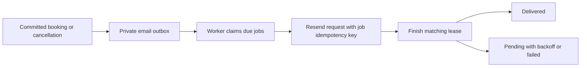

# Connect the database

The app supports Supabase PostgreSQL, password accounts, and optional
authenticator verification while remaining
deployable as the existing browser demo. This repository does not provision or
connect a hosted project automatically.

This README explains the database functions as they behave **after all six
migrations have been applied**. A function appearing in an early migration may
be replaced by a later one; for example, the final `create_booking` implementation
is in the availability migration, not the original marketplace file. For the
screens and TypeScript callers, read the [app guide](../README.md) and
[source-function reference](../src/README.md).

## Reading guide

- [Set up Supabase and Netlify](#set-up-supabase-and-netlify): create or connect the project.
- [Data model and access boundaries](#data-model-and-access-boundaries): what is stored and who can see it.
- [Public database function reference](#public-database-function-reference): RPC names, arguments, results, and permission checks.
- [How a booking transaction works](#how-a-booking-transaction-works): validation, locks, retries, and snapshots.
- [How availability is calculated](#how-availability-is-calculated): opening hours, intervals, breaks, buffers, and dates.
- [How the email outbox works](#how-the-email-outbox-works): queue creation, claims, acknowledgments, and retries.
- [Migration files and maintenance](#migration-files-and-maintenance): file order, test coverage, and safe recovery.

## Set up Supabase and Netlify

1. Create a project at [Supabase](https://supabase.com/dashboard). Choose a
   Canadian database region if available for your account. Keep the database
   password in your own password manager.
2. Create the database schema using one migration workflow. If Supabase's
   GitHub integration or CLI is managing migrations, let that workflow apply
   the files in `migrations/` in filename order. For a SQL Editor-only setup,
   run [`migrations/202610220001_marketplace.sql`](migrations/202610220001_marketplace.sql)
   once, followed by
   [`migrations/202610230001_listing_photos.sql`](migrations/202610230001_listing_photos.sql),
   [`migrations/202610230002_account_security.sql`](migrations/202610230002_account_security.sql),
   [`migrations/202610260001_host_management.sql`](migrations/202610260001_host_management.sql),
   [`migrations/202610260002_host_availability.sql`](migrations/202610260002_host_availability.sql),
   and [`migrations/202610260003_booking_notifications.sql`](migrations/202610260003_booking_notifications.sql).
   The first creates the four app tables and booking functions; the second
   creates photo storage and permissions; the third enforces authenticator
   verification for enrolled accounts; the fourth adds ownership-based host
   management and editing; the fifth adds host schedules and authoritative
   availability; the sixth creates the private booking-email outbox. **If the four app tables already
   exist, do not rerun the initial setup.** Manual SQL does not record migration
   history automatically. Before enabling automatic deployments for an existing
   manual setup, follow the [migration history recovery guide](repairs/README.md).
3. Optionally run [`seed.sql`](seed.sql) in the SQL Editor to populate the
   fictional Alberta studios from the demo. Skip this for an empty catalogue.
   These seeded businesses are marked as samples; their bookings do not notify
   a real provider. The seed does not upload browser data or create accounts.
4. In **Authentication → URL Configuration**, set **Site URL** to your published
   Netlify address and add that exact URL to **Redirect URLs**. Include the
   trailing slash if your app is served at `/`. For local development, also
   allow `http://localhost:5173/` or the exact local origin you use. Add the
   password recovery URL as well, for example
   `https://airsthetic.netlify.app/?account=recovery` (and its local equivalent).
5. Enable the Email authentication provider for email/password accounts. Keep
   email confirmation enabled for new registrations. Supabase's built-in email sender has recipient
   restrictions and rate limits; configure custom SMTP before inviting public
   users. Test confirmation and password-reset delivery with an account you control.
6. In Supabase **Project Settings → API**, copy the **Project URL** and the
   **publishable key**. In Netlify **Project configuration → Environment
   variables**, add these for the builds you want connected:

   ```text
   VITE_SUPABASE_URL=https://your-project.supabase.co
   VITE_SUPABASE_PUBLISHABLE_KEY=sb_publishable_...
   ```

   A legacy public `anon` key works under `VITE_SUPABASE_ANON_KEY` instead.
   These are intentionally public browser settings. Never put a `service_role`
   or `sb_secret_` key in a `VITE_` variable, repository, or chat. No private key
   is needed by this frontend.

7. Trigger a new Netlify deploy. Vite reads these variables **at build time**.
   Wait for **Published**, then open the site, sign in, publish a listing, and
   check it from a second browser. Test booking and cancellation in both
   browsers. Remove both connection variables and rebuild to return to demo
   mode.

For local use, copy `.env.example` to `.env.local`, replace its placeholders
with your project URL and public key, and restart Vite. `.env.local` is ignored
by Git. Do not copy the placeholder values into a live deployment.

## If a sign-in email fails

The default Supabase sender only delivers to email addresses belonging to your
Supabase **organization team**. To test before configuring email delivery, use
your Supabase account's email address. Adding an address under Authentication
→ Users does not make it an approved recipient for the default sender.

For public sign-ups, configure a custom email provider in **Authentication →
SMTP Settings**. Follow the provider's sender/domain verification instructions,
enter its SMTP settings directly in Supabase, and test delivery there. SMTP
passwords and API secrets belong in Supabase's SMTP settings, never in the Vite
frontend or Netlify's `VITE_` variables. See [Supabase's SMTP guide](https://supabase.com/docs/guides/auth/auth-smtp).

The sign-in form distinguishes restricted recipients, email request limits,
disabled email sign-in, connection settings, and delivery/network failures.
If a request is rate limited, allow time before requesting another link rather
than repeatedly clicking Send. For an unrecognized failure, inspect the latest
Auth error in Supabase's project logs.

`VITE_SUPABASE_URL` should be the project origin ending in `.supabase.co`, or
your configured custom domain. The app also accepts the Data API panel's
`/rest/v1/` URL and normalizes it to the project origin before making requests.

## Passwords and authenticator apps

**Log in** uses email and password without sending a new email on each login.
**Create account** registers a password and asks for email confirmation when
enabled in Supabase. The app requires at least eight characters for a new
password; stronger password rules configured in Supabase also apply.

Existing email-link users can use **Forgot password** to receive a reset link,
or log in with **Use an email link instead** and set a password under **Account**.
The fallback link cannot create a new account. Password recovery requires the
valid session established by Supabase's recovery link; the URL flag alone does
not authorize a password change. Supabase manages passwords, not app tables or
browser demo storage. Sessions restore after reload until sign-out or expiry.

In **Account**, choose **Enable authenticator**, scan the QR code in an app such
as Google Authenticator, Microsoft Authenticator, or 1Password, then verify its
six-digit code. Setup is not complete until verification succeeds. Cancelling
removes the unfinished factor. Supabase enables TOTP by default; see its
[authenticator guide](https://supabase.com/docs/guides/auth/auth-mfa/totp).

After enrollment, each new password or email-link session requires a code before
private favourites/bookings can load or account actions can proceed. The
database enforces this as well as the UI. A verified session can remove the
authenticator in **Account**. This initial version does not generate backup
codes or provide automatic lost-device recovery; use an authenticator with
secure backup and keep access to it. An account with a lost factor requires
the site owner's identity-checked recovery process in Supabase.

## Data and access rules

- Everyone can read published listings and their services. Signed-in users can
  publish a listing. New listings retain the confirmed map location and receive
  server-generated IDs; fabricated client ratings and reviews are discarded.
- A listing can include up to 8 JPEG, PNG, or WebP photos, up to 5 MiB each.
  The first photo is the cover; it can be changed or removed before publication.
  The browser resizes and re-encodes uploads, removing camera metadata. Photos
  are public in the `listing-photos` Storage bucket and are uploaded when the
  user publishes. Upload permissions are limited to the signed-in user's UUID
  folder; clients cannot overwrite another user's files or delete photos used
  by a published listing. Failed uploads keep form details and can be retried.
  A retry after a listing-save error reuses the existing uploaded URLs.
- Favourites belong to their signed-in user. Booking names and email addresses
  are available to the customer and to the owner of the booked space through
  the protected host dashboard RPC. Public and unrelated signed-in users cannot
  read them. The site owner can administer records using Supabase's dashboard.
- Public availability exposes schedules, bookable times, or, through the legacy
  busy-time function, occupied times and durations. It never exposes customer details.
  The booking function checks the service, uses its database price and duration,
  applies Alberta time and opening hours, and atomically prevents overlapping
  appointments. Request IDs make identical retries safe.
- Customers can cancel their own appointments; hosts can cancel appointments
  for spaces they own. Both release the slot after database confirmation. There
  are no direct browser booking-write grants.
- Signed-out pages clear account data. Cloud booking/contact records are not
  written to the old browser demo keys. Supabase keeps a sign-in session in the
  browser so a reload can restore the account.
- Enrolled accounts need a Supabase `aal2` session for private reads, favourites,
  listing photo uploads/deletes, and booking/listing RPC mutations. Authenticator
  codes and setup secrets are not saved in app storage. Public discovery,
  listing photos, and anonymous availability remain available.
- Existing local listings, saved places, and demo bookings stay separate. There
  is **no automatic upload or migration** of old contact details.
- Missing both connection settings selects demo mode. Partial/invalid settings,
  authentication failures, and network/database errors are shown as errors;
  configured cloud mode never silently falls back to local storage.

In demo mode, uploaded photos are compressed and saved in browser storage with
the listing. A bounded gallery budget and storage-quota checks keep failed
saves visible. Photos are never automatically uploaded when switching from
demo mode to a connected project. Files left behind by abandoned or interrupted
publication attempts may require periodic cleanup by the site owner; never
delete an upload that might belong to an in-progress publication.

## Managing a business

Existing spaces remain attached to their stored `owner_id`; hosts find them
under **My business** after signing into that account. No manual ownership
assignment or data migration is needed. Demo listings without a real owner are
not claimable through the app.

The first listing uses `create_listing`. A distinct request from an account
that already owns a space is rejected; an identical request retry still returns
the original space. **Add another location** calls `create_additional_listing`
explicitly. Both routes share an account lock to prevent accidental duplicates
from two tabs. Existing accounts with multiple spaces keep all of them.

`get_host_dashboard()` derives ownership from `auth.uid()` and returns only
the account's spaces and their client appointments. `update_listing` checks
ownership and MFA, validates the new profile/location/services, and preserves
IDs, ownership, creation/request metadata, ratings, reviews, and existing booking
snapshots. The editor retains the service set so booked service references stay
valid; adding or removing services is future work. `host_cancel_booking` checks
the ownership of the appointment's listing. These functions do not grant direct
table updates or change customer-only booking RLS.

Use **Refresh** to check for new appointments. The dashboard also refreshes when
the window gains focus or the page reloads. Cloud
host contact details stay out of demo browser storage and clear on sign-out or
account/security changes. Removed photos are unlinked from the edited gallery;
they are not automatically deleted from Storage, which avoids breaking existing
booking image snapshots or in-progress publication retries.

The initial model reserves one appointment at a time per listing. Multiple
staff calendars, listing moderation, payments, push notifications, and self-service account
deletion are later work. For account removal, the site owner must remove or
reassign owned listings and their dependent records before deleting the user
in Supabase Auth. Signing out does not delete database records.

## Host availability

**My business → Manage availability** saves weekly opening hours, breaks, closed
days, up to 366 blocked dates, booking intervals of 15/30/60 minutes, and a
0–120 minute buffer. Dates and booking times use `America/Edmonton`.
The first interval starts at that day's opening time. The appointment and its
trailing buffer must fit the open period and avoid breaks and existing bookings.
Previously created bookings stay unchanged when hours or buffers change.

`get_listing_schedule` and `available_booking_slots` are public, and expose only
schedule rules and bookable times. `update_listing_schedule` checks ownership
and MFA. The booking function validates the schedule again inside its
transaction, with a per-listing lock to prevent simultaneous bookings from
overlapping their buffers. Missing schedules retain the existing 9 AM–6 PM
daily hours and hourly slots until the host changes them.

## Booking emails

The notification migration queues confirmations, cancellations, and 24-hour
reminders for real host-created listings. Sample/demo listings do not enqueue
emails. No historical bookings are backfilled. Reminders are scheduled only for
bookings made more than 24 hours ahead, and pending reminders are suppressed
when a booking is cancelled.

Email jobs live in the private schema. Only the server's `service_role` can
claim/finish jobs; account clients cannot read recipients or impersonate a worker.
Leases, retry limits, backoff, and provider idempotency keys handle interrupted
delivery. Follow [the email delivery guide](../docs/booking-emails.md) to configure
Resend and Netlify's server-only keys. This is separate from Supabase's SMTP
configuration for account confirmation and password recovery. Without provider
settings, the worker leaves jobs unclaimed and sends nothing.

The iPhone app shares these same database rules and email jobs. Native account
links need the additional redirect URLs in [the iPhone guide](../docs/iphone.md).

## Data model and access boundaries

Supabase Auth owns accounts, passwords, sessions, and authenticator factors. The
app does not create a separate password table or store password values inside a
listing. The database uses `auth.uid()` from the validated request session to
identify the caller. An `owner_id` or `customer_id` supplied by a browser does
not authorize access to someone else's records.

| Table or managed resource                | Important fields                                                                                                                    | Purpose and access                                                                                                                                                                                                                     |
| ---------------------------------------- | ----------------------------------------------------------------------------------------------------------------------------------- | -------------------------------------------------------------------------------------------------------------------------------------------------------------------------------------------------------------------------------------- |
| `auth.users`                             | `id`, `email` and Supabase-managed account fields                                                                                   | Supabase account identity. App ownership references its UUID. The private email trigger reads the host account email; public listing results do not expose it.                                                                         |
| `auth.mfa_factors`                       | `user_id`, `status`, factor type                                                                                                    | Supabase-managed second-factor enrollment. The assurance helper checks verified factors without granting browser clients access to the factor table.                                                                                   |
| `public.listings`                        | `id`, `owner_id`, `is_demo`, `request_id`, `request_fingerprint`, `data`, `created_at`                                              | Public published space. `data` contains profile fields, photos, coordinates, amenities, professional details, and server-controlled reviews/ratings. Services are stored separately.                                                   |
| `public.services`                        | `id`, `listing_id`, `name`, `description`, `duration`, `price`                                                                      | Public service catalogue. IDs are generated on creation and retained during edits. The `(listing_id, id)` relationship ensures a booking cannot attach another space's service.                                                        |
| `public.favorites`                       | `user_id`, `listing_id`, `created_at`                                                                                               | A customer's saved spaces. The composite primary key prevents duplicate favourites. RLS allows only the caller's reads, inserts, and deletes, with the additional MFA requirement.                                                     |
| `public.bookings`                        | `id`, `customer_id`, `listing_id`, `service_id`, guest contact fields, date/time, snapshot fields, `status`, `starts_at`, `ends_at` | Private appointment record. Direct authenticated reads are customer-only under RLS. The separate host RPC returns appointments for the caller's owned spaces. Browser clients have no direct booking insert, update, or delete grants. |
| `airstethics_private.listing_schedules`  | `listing_id`, `schedule`, `updated_at`                                                                                              | One saved schedule per space. Clients use narrowly scoped RPCs; they do not read or write this private table directly.                                                                                                                 |
| `airstethics_private.booking_email_jobs` | `id`, `booking_id`, event/recipient fields, `payload`, `due_at`, `status`, `attempts`, lease and delivery fields                    | Private transactional email outbox. Even `service_role` uses the worker RPCs rather than receiving a table grant from this migration.                                                                                                  |
| `storage.buckets` / `storage.objects`    | Bucket `listing-photos`; object key and metadata                                                                                    | Supabase Storage holds the photo bytes. The bucket's public URLs serve images; metadata listing, uploads, and permitted cleanup are scoped to the current account's folder.                                                            |
| `supabase_migrations.schema_migrations`  | `version`, optional `name`, optional `statements`                                                                                   | CLI/GitHub migration history. A manually pasted SQL file does not automatically create its history row. This table is deployment metadata, not app content.                                                                            |

`airstethics_private` is a PostgreSQL schema, not a second database. Its functions
and tables are not part of the browser-facing table API. Public mutation RPCs
are `SECURITY DEFINER` functions with an empty fixed `search_path`; their SQL
uses explicit schema names and performs its own ownership and assurance checks.
Restrictive RLS policies remain relevant to direct favourite and booking reads.

The initial marketplace publishes every listing. There is no private draft,
moderation status, ownership transfer, service deletion, or client-side account
deletion RPC in this schema.

### Photos and their ownership

An upload key has this form:

```text
{account UUID}/{listing request UUID}/{photo UUID}.webp
```

The policy also accepts the supported `jpg`, `jpeg`, and `png` extensions. The
first folder must match the signed-in user's UUID. There is no overwrite/update
policy: the client uploads with `upsert: false` and new UUID keys. A delete is
allowed only in the caller's folder and only while no published listing's cover
or gallery references that object's public URL. Verified-MFA accounts must be
at AAL2 for inserts and deletes. Public image delivery remains public.

The app UI limits a gallery to eight photos and processes input files up to
5 MiB each. The bucket independently enforces the 5 MiB object size and supported
MIME types. The SQL listing payload helper permits a larger bounded image array
(up to 100); the eight-photo product limit is enforced by the current client.
Editing a gallery unlinks removed images; it does not automatically delete the
underlying objects or rewrite historical booking image snapshots.

## Public database function reference

Supabase exposes these functions under `/rest/v1/rpc/<function_name>`. The
frontend normally calls them with `supabase.rpc(name, arguments)`. Argument names
must match the `p_...` names below. Return types shown here are PostgreSQL types:
the TypeScript backend normalizes the resulting JSON before placing it in UI
state.

“Authenticated + assurance” means a valid account session for which
`account_has_required_assurance()` returns true. If no verified second factor
exists, AAL1 is sufficient. Once a verified factor exists, the request JWT must
contain `aal: "aal2"`.

| Function signature                                                                                                                 | Caller and return                                                                        | What it actually does                                                                                                                                                                                                                                                                                                                                                                     |
| ---------------------------------------------------------------------------------------------------------------------------------- | ---------------------------------------------------------------------------------------- | ----------------------------------------------------------------------------------------------------------------------------------------------------------------------------------------------------------------------------------------------------------------------------------------------------------------------------------------------------------------------------------------- |
| `account_has_required_assurance()`                                                                                                 | Authenticated; `boolean`                                                                 | Returns false without an account. Otherwise returns true when the JWT is AAL2 or the account has no verified MFA factors. Reads factor enrollment on the server, so an old AAL1 token cannot bypass a newly enabled authenticator. Defined in [account security](migrations/202610230002_account_security.sql).                                                                           |
| `create_listing(p_listing jsonb)`                                                                                                  | Authenticated + assurance; one `public.listings` row                                     | Creates the account's first real space. The payload's UUID-like `id` is a request identifier; the database creates the permanent listing/service IDs. Rejects a distinct primary request if that account already owns a real space. An exact original request retry returns the existing space. Current entry point is in [host management](migrations/202610260001_host_management.sql). |
| `create_additional_listing(p_listing jsonb)`                                                                                       | Authenticated + assurance; one `public.listings` row                                     | Uses the same validation, ownership, request deduplication, and account lock as first-space creation, but explicitly permits another location. The caller cannot select a different owner.                                                                                                                                                                                                |
| `update_listing(p_listing_id text, p_listing jsonb)`                                                                               | Owning host + assurance; one `public.listings` row                                       | Locks the owned non-demo listing; validates profile, category, city, location, images, amenities, professional, and every existing service. Updates editable fields and normalized service values together. Preserves owner, permanent IDs, creation/request metadata, ratings, reviews, and existing booking snapshots.                                                                  |
| `get_host_dashboard()`                                                                                                             | Authenticated + assurance; `jsonb` object                                                | Returns `{ "listings": [...], "bookings": [...] }` for real spaces whose `owner_id` equals `auth.uid()`. Listing entries contain `id`, `data`, `is_demo`, and normalized `services`; booking entries are complete appointment rows, including necessary guest contact details. An account with no spaces gets two empty arrays. No owner UUID argument is accepted.                       |
| `create_booking(p_listing_id text, p_service_id text, p_date date, p_time time, p_guest_name text, p_guest_email text, p_id uuid)` | Authenticated + assurance; one `public.bookings` row                                     | Performs the authoritative booking transaction described below. It takes service values from the database, checks current host availability, serializes competing requests for the listing, and returns the committed snapshot. The final implementation is in [host availability](migrations/202610260002_host_availability.sql).                                                        |
| `cancel_booking(p_id uuid)`                                                                                                        | Booking customer + assurance; one `public.bookings` row                                  | Marks that customer's booking `cancelled`. It does not delete the row, charge/refund money, or call an email provider. Repeating a cancellation for the same owned row returns its cancelled state. A real confirmed-to-cancelled transition also triggers the email outbox.                                                                                                              |
| `host_cancel_booking(p_id uuid)`                                                                                                   | Owning host + assurance; one `public.bookings` row                                       | Cancels a booking only if its listing is a non-demo space owned by the caller. Uses the same stored cancelled status and outbox trigger; it does not broaden customer-table RLS.                                                                                                                                                                                                          |
| `get_listing_schedule(p_listing_id text)`                                                                                          | Anonymous or authenticated; `jsonb`                                                      | Returns the saved public schedule, or the default seven-day 09:00–18:00 schedule if none is stored. A nonexistent listing raises a validation error. This response contains hours and blocked dates, not private notes or customer details.                                                                                                                                               |
| `update_listing_schedule(p_listing_id text, p_schedule jsonb)`                                                                     | Owning host + assurance; normalized schedule `jsonb`                                     | Takes an exclusive lock on the caller's real listing, validates and sorts the schedule, then inserts or replaces its private schedule row. Updates `updated_at`. Does not move or cancel appointments.                                                                                                                                                                                    |
| `available_booking_slots(p_listing_id text, p_date date, p_service_id text)`                                                       | Anonymous or authenticated; rows `{ booking_time }`                                      | Returns only starts that fit the selected service and the listing's current schedule, buffer, confirmed appointments, and future/90-day limits. A wrong/missing service or date outside the booking horizon produces no rows. This is the current booking-screen API.                                                                                                                     |
| `listing_availability(p_listing_id text, p_date date)`                                                                             | Anonymous or authenticated; rows `{ booking_time, duration }`                            | Legacy busy-time API from the initial migration. Returns confirmed busy starts/durations within the allowed date horizon, with no guest data. It is retained for compatibility; it does not calculate opening-hour rules or available starts.                                                                                                                                             |
| `claim_booking_emails(p_limit integer = 25)`                                                                                       | `service_role` only; rows `{ id, recipient, emailkind, payload, attempts, lease_token }` | Claims 1–100 due jobs, ordered by due time, using `FOR UPDATE SKIP LOCKED`. Marks them processing, increments attempts, and issues a five-minute lease token. The deployed worker requests five jobs, not the function's default 25.                                                                                                                                                      |
| `finish_booking_email(p_id uuid, p_lease_token uuid, p_delivered boolean, p_error text = null)`                                    | `service_role` only; `boolean`                                                           | Acknowledges only a matching current lease. Successful delivery becomes `delivered`; failure schedules a retry or marks the job failed after its attempt limit. Missing IDs, wrong/stale leases, or inappropriate job status return false. Repeating the same successful acknowledgment with the same token returns true.                                                                 |

### Listing payload rules

The JSON passed to creation/editing uses the `Listing` shape in
[`src/data.ts`](../src/data.ts), including `services`. Database records store
services in `public.services`, not inside `listings.data`. Important validation
rules are:

- Category must be Hair, Nails, Skin, Brows & lashes, Massage, or Makeup.
- City must be Edmonton, Calgary, or Canmore. Coordinates must be numeric and
  inside that city's supported bounding box, rather than arbitrary global coordinates.
- Creation accepts a UUID or `local-<UUID>` request ID. Its original full JSON
  fingerprint is retained for exact retry comparison.
- Space/professional names, description, neighbourhood, image sources, amenities,
  and service fields have bounded text/array sizes. A service has a whole-minute
  duration from 1–540 and a creation/edit price from CAD 5–1,000, with at most two
  decimal places. The underlying service table's broader numeric check is not
  the public mutation function's product limit.
- Creation accepts 1–100 services and generates their stored IDs. Editing must
  include the existing service count and each existing service ID exactly once.
  It cannot add, remove, duplicate, or borrow another listing's service IDs.
- The server replaces submitted creation ratings/reviews with a new-listing
  state; editing retains the previously stored server fields.

An edit is atomic, but there is no version/ETag conflict field: two legitimate
edits to the same space are serialized and the later successful edit can replace
the earlier editable values. Reopening the editor loads the stored result.

### Error codes and retry meaning

| SQLSTATE | Typical cause                                                                                      | Expected caller action                                                                                       |
| -------- | -------------------------------------------------------------------------------------------------- | ------------------------------------------------------------------------------------------------------------ |
| `42501`  | Missing authentication, unfinished MFA challenge, wrong owner/customer, or forbidden worker access | Restore the proper session/verification; never retry with a browser-supplied owner ID.                       |
| `22023`  | Invalid field, schedule, coordinate, date/time shape, or missing listing/service                   | Keep the entered form and let the user correct it or reload the current record.                              |
| `23514`  | A distinct first-space request from an account that already has a space                            | Open **My business** or use the explicit additional-location flow.                                           |
| `23505`  | A request ID was reused for different booking/listing input                                        | Use a fresh request ID for genuinely changed input; preserve the original ID for an identical network retry. |
| `23P01`  | Occupied/blocked/out-of-schedule time or overlap constraint conflict                               | Reload available slots and ask for another start time.                                                       |

An SQL result is not necessarily the final user-facing sentence. The backend
maps provider/database errors into fixed messages; see
[`src/backend.ts`](../src/backend.ts). A network timeout is ambiguous: the
transaction may already have committed. This is why request IDs survive an
identical retry and the UI waits for server confirmation.

## How a booking transaction works

1. The browser asks `available_booking_slots` for a selected listing, service,
   and date. That result is a preview of availability, not a reservation.
2. On **Book my appointment**, the caller submits the seven `p_...` arguments.
   It sends service/listing IDs and contact details, not an authoritative price,
   duration, owner ID, or customer ID.
3. `create_booking` checks account assurance and guest field lengths/format. It
   acquires a shared row lock on the listing. Profile, service, and schedule
   edits require an exclusive listing lock, so a booking snapshots a coherent
   state before or after the edit.
4. A listing-specific advisory transaction lock serializes slot validation and
   insertion across competing booking requests. This is necessary for buffer
   conflicts even when the actual appointments do not overlap.
5. An already-stored `p_id` is compared with the original customer, listing,
   service, date, time, guest name, and guest email. Exact retries return that
   booking before rechecking current availability. A different request using the
   same ID raises `23505`. Retrying a cancelled record does not create a new appointment.
6. The current service is loaded from the listing. The requested start must
   still appear in `available_booking_slots`; a stale selection fails `23P01`.
7. The insert snapshots the listing name/image/city and service name, duration,
   and price. Alberta local date/time is converted into UTC-aware `starts_at`
   and `ends_at`. Later listing/service changes leave these snapshot columns intact.
8. The GiST exclusion constraint is a second protection against overlapping
   actual `[starts_at, ends_at)` ranges for confirmed bookings. It covers the
   entire listing, regardless of selected service or customer.
9. The after-insert trigger records eligible email jobs inside the same database
   transaction. No HTTP/email-provider request runs inside this transaction.
10. The committed booking row returns to the caller. The frontend updates its
    appointment book and shows success. The separate worker can deliver email
    later; a saved booking does not prove email delivery.

Cancellation changes status instead of deleting history. The exclusion
constraint and available-slot query ignore cancelled records, releasing the
time for a new request. There is no rescheduling RPC, provider approval step,
payment charge/refund, or completed/no-show status in the current implementation.

## How availability is calculated

The public schedule JSON has exactly the application fields shown below. This
short example shows one weekday entry; an actual saved schedule must include
all seven unique `day` values, where Sunday is `0` and Saturday is `6`.

```json
{
  "weekly": [
    {
      "day": 1,
      "enabled": true,
      "start": "09:15",
      "end": "18:00",
      "breaks": [{ "start": "12:00", "end": "13:00" }]
    }
  ],
  "blockedDates": [{ "date": "2030-12-25" }],
  "bufferMinutes": 15,
  "slotMinutes": 30
}
```

`validate_listing_schedule` rejects oversized JSON, malformed/missing fields,
duplicate weekdays/dates, non-integer interval/buffer values, more than 12 breaks
per day, and more than 366 blocked dates. Times use `HH:MM` and must describe the
same day: opening must be before closing, each break must fit inside the hours,
and breaks cannot overlap. These structural checks also apply to disabled days.
Overnight opening windows are not supported. It normalizes weekday order, break
order, blocked-date order, and strips unrelated JSON fields before saving.

For a valid date from today through 90 days ahead in `America/Edmonton`:

1. Find the service duration and the schedule's weekday entry.
2. Return no starts for a disabled weekday or explicitly blocked date.
3. Generate candidate starts beginning at the opening time and advancing by
   `slotMinutes`. With a 09:15 opening and 30-minute grid, starts are 09:15,
   09:45, 10:15, and so on; the grid is not anchored to midnight.
4. Require the service **plus its trailing buffer** to fit before closing and
   avoid all breaks. A 60-minute service with a 15-minute buffer needs a
   75-minute free interval.
5. Compare that candidate interval with every confirmed booking's stored actual
   start/end extended by the current buffer. Half-open ranges let a candidate
   begin exactly when the preceding buffered interval ends.
6. Reject starts already passed in Alberta local time. SQL converts to real
   timestamps, rejects nonexistent spring-forward local times, and offers only
   PostgreSQL's selected standard-time occurrence of a repeated fall-back time.
7. Return the remaining starts as `booking_time` rows, with no customer information.

Changing a buffer can remove new choices around old bookings; it does not
retroactively adjust, cancel, or move those bookings. The browser-demo helper
in [`src/availability.ts`](../src/availability.ts) mirrors ordinary local
schedule rules; production booking authority is the SQL function and its locks.

## How the email outbox works

The `booking_email_outbox` trigger calls the private `queue_booking_emails()`
function after an insert or an update of `bookings.status`:

| Event                                                                                    | Jobs created                                                             | Conditions                                                                                                                                                                                              |
| ---------------------------------------------------------------------------------------- | ------------------------------------------------------------------------ | ------------------------------------------------------------------------------------------------------------------------------------------------------------------------------------------------------- |
| New confirmed booking                                                                    | Confirmation for customer and host; reminder for each eligible recipient | Listing must be real/non-demo and have an owner. Customer recipient is the booking's guest email; host recipient is the owner's Auth email. Invalid/missing addresses are skipped rather than invented. |
| Booking made more than 24 hours before start                                             | Reminder due at `starts_at - 24 hours`                                   | This strict creation-time condition avoids immediately sending a reminder for a near-term booking.                                                                                                      |
| Confirmed booking becomes cancelled                                                      | Cancellation for eligible customer/host recipients                       | Any pending/processing confirmation or reminder jobs are marked cancelled and their leases invalidated.                                                                                                 |
| Repeated cancelled-to-cancelled update, exact booking retry, or fictional sample listing | No duplicate event jobs                                                  | A unique `(booking_id, emailkind, recipient_role)` key and conflict-ignore insert also protect duplication.                                                                                             |

The trigger snapshots the booked profile/service/contact details into JSON,
adds the recipient role, and stores a due time. It neither contacts Resend nor
checks whether Netlify has email keys configured. Old bookings are not backfilled
when the migration is applied. A missing host email still allows the customer
job and booking to be saved.

The worker workflow is:



`claim_booking_emails` first suppresses obsolete confirmation/reminder jobs for
cancelled or already-started appointments. It marks exhausted expired jobs
failed, selects due unlocked work with `SKIP LOCKED`, and issues fresh lease
tokens. An interrupted worker's five-minute lease can later be reclaimed;
another active worker does not receive the same locked row.

`finish_booking_email` locks the job row and verifies the token. A successful
acknowledgment records delivery time. Failure increments no second counter—the
claim already incremented `attempts`—and schedules exponential delay starting
at 60 seconds, capped at 3,600 seconds. The eighth failed attempt becomes
`failed`. Only a bounded category matching `[a-z0-9_:-]` is stored as an error;
arbitrary provider text is replaced by `delivery_failed`.

The Netlify worker runs every 15 minutes, requests at most five jobs per run,
and uses provider idempotency keys derived from job IDs. Therefore delivery and
reminders are not promised to arrive at an exact second. A provider-accepted
message cannot be recalled after cancellation, and idempotency retention does
not guarantee exactly-once email across an indefinite outage. See the
[worker setup/operations guide](../docs/booking-emails.md) for actual server-only
keys, provider configuration, and safe testing. Missing provider settings mean
no jobs are claimed and no mail is sent.

## Migration files and maintenance

| Apply order | File                                                                                          | What it contributes                                                                                                                                                   |
| ----------- | --------------------------------------------------------------------------------------------- | --------------------------------------------------------------------------------------------------------------------------------------------------------------------- |
| 1           | [`202610220001_marketplace.sql`](migrations/202610220001_marketplace.sql)                     | Four public app tables, constraints, base RLS, input helpers, initial booking/listing/cancellation functions, and legacy busy-time availability.                      |
| 2           | [`202610230001_listing_photos.sql`](migrations/202610230001_listing_photos.sql)               | Public photo bucket and owner-namespace insert/select/delete policies.                                                                                                |
| 3           | [`202610230002_account_security.sql`](migrations/202610230002_account_security.sql)           | Assurance helper, restrictive private-account/photo-write policies, and protected mutation wrappers; moves original mutation implementations into the private schema. |
| 4           | [`202610260001_host_management.sql`](migrations/202610260001_host_management.sql)             | First/additional-space entry points, owned dashboard, editing, host cancellation, and coherent edit/booking locking.                                                  |
| 5           | [`202610260002_host_availability.sql`](migrations/202610260002_host_availability.sql)         | Private schedules, schedule validation/public availability functions, and the final schedule-aware `create_booking`.                                                  |
| 6           | [`202610260003_booking_notifications.sql`](migrations/202610260003_booking_notifications.sql) | Private email queue, booking trigger, service-only claim/finish RPCs, and queue indexes.                                                                              |

The initial table-creation migration is not safe to rerun over an existing
schema. Later files deliberately use replace/upsert/drop-if-exists patterns for
their own supported upgrade/reapplication paths; this is not a reason to run all
files repeatedly by hand. Let one configured migration workflow record and
apply new versions in order. For an original manually created schema whose
first history row is missing, follow the [guarded repair guide](repairs/README.md).
The repair records only the initial version; it does not declare later files
applied or change app records.

[`seed.sql`](seed.sql) is optional and separate from migrations. It inserts
fictional catalogue listings with `owner_id = null` and `is_demo = true`, and
uses conflict-ignore inserts so existing IDs are not overwritten. It creates
no Auth accounts, appointments, private contact details, or email jobs. Running
`node supabase/generate-seed.mjs` regenerates the SQL file from the public sample
catalogue and geographic fallback helper; it does not apply SQL to any database.

The local database harness starts disposable PostgreSQL 16 with minimal Auth and
Storage substitutes, applies historical fixtures, then upgrades the populated
database through host management, availability, and notifications. It checks
existing-data preservation and migration reapplication, along with concurrent
booking slots, same-request retries, first-space duplication prevention,
edit/booking snapshot consistency, buffered races, and parallel email claims.
These checks validate SQL behavior locally; they do not prove that a particular
hosted Supabase deployment or live email provider is configured.

## Validate changes

```sh
npm run build
npm test
npm run test:cloud
npm run test:database
npm run test:emails
npm run test:native
```

The default browser suite checks the unconfigured demo. The cloud suite uses a
separate Vite server and mocked Supabase endpoints with fictitious public
settings; it does not connect to your project. The database suite requires
Docker and tests the actual migration in an isolated PostgreSQL 16 container,
including user isolation, server validation, and simultaneous booking attempts.
It publishes no host ports, attaches no persistent volume, and removes its
container afterward. Its minimal `auth.users`/`auth.uid()` substitutes exist only
in the test bootstrap, never in the hosted migration.

To regenerate the optional fictional seed after changing the source listings:

```sh
node supabase/generate-seed.mjs
```
